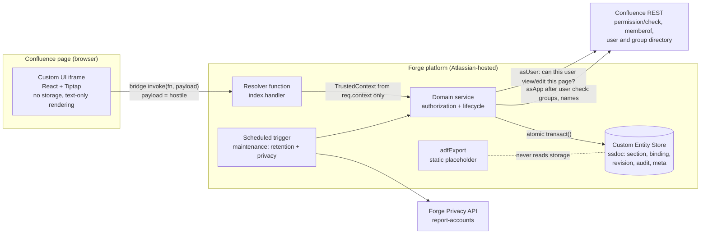

# Architecture

## Overview

```
repo
├─ manifest.yml                 Forge manifest (macro, 3 functions, 1 scheduled trigger, storage entity, scopes)
├─ packages/shared              Types and pure logic used by both sides: roles, editor schema/validator, contracts, i18n
├─ src/                         Forge functions (Node 24)
│  ├─ index.ts                  handler (resolver), adfExport, maintenance
│  ├─ resolvers.ts              Typed resolver surface; builds identity only from req.context
│  ├─ domain/                   Authorization, section service, audit chain, retention, privacy (no Forge imports)
│  ├─ ports/                    Interfaces: Store, ConfluenceGateway, PrivacyGateway, Clock, IdGenerator, Logger
│  ├─ adapters/                 kvs-store.ts (@forge/kvs), forge-gateway.ts (@forge/api)
│  └─ testing/                  In-memory store and fake Confluence for contract/security tests (never shipped as evidence of Forge behaviour)
├─ static/macro-ui              Custom UI (React 19, Tiptap 3, Vite); harness/ is test-only
├─ e2e/                         Playwright UI tests against the harness
└─ tests/                       Resolver-surface security matrix
```

The domain depends only on ports, so everything that is pure logic runs in unit tests. Only two files talk to
Forge: `adapters/kvs-store.ts` and `adapters/forge-gateway.ts`. Those two are the **unverified** surface
(see spikes S4, S5, S7 in docs/PLATFORM_FINDINGS.md).

## Data flow



Trust boundaries:

1. Browser to resolver: everything in `payload` is attacker controlled. Identity, page, tenant and macro come
   from `req.context`, which Atlassian documents as secure and unalterable.
2. Resolver to Confluence: the user's own page rights are checked with `asUser` before any secret is read;
   `asApp` is limited to non-secret directory data.
3. Domain to storage: every record carries `cloudId`; the binding record is looked up by
   (`pageId`, `localId`) from the trusted context, then identity-checked against the stored record.

## Storage model

One declared entity `ssdoc` with attributes `rev` (integer, optimistic concurrency), `p` (partition, string),
`r` (range, string) and `payload` (any), and one index `by-partition` (partition `p`, range `r`). The adapter
stores the logical entity name inside `p` (`<entity>|<partition>`), which keeps within the platform limit of
20 entities and 7 indexes and allows ordered, paginated listing per section.

| Logical entity | Key                          | Partition       | Range          | Notes                                                                                         |
| -------------- | ---------------------------- | --------------- | -------------- | --------------------------------------------------------------------------------------------- |
| `section`      | sectionId (UUID)             | `all`           | sectionId      | Owner, ACL grants (<=500), bindings (<=20), head version, aclVersion, audit head hash, status |
| `binding`      | `pageId:localId`             | `page:<pageId>` | localId        | cloudId, sectionId, kind (CREATE/COPY/REBIND). The security anchor.                           |
| `revision`     | `sectionId:<padded version>` | sectionId       | padded version | content JSON + sha256, author, restoredFrom                                                   |
| `audit`        | `sectionId:<id>`             | sectionId       | entry id       | action, actor, meta, prevHash, hash                                                           |
| `meta`         | name                         | `meta`          | name           | retention/privacy cursors, retention config                                                   |

Multi-record invariants are enforced by `transact()` with `expectRev` conditions (compare-and-set on `rev`)
and `create` conditions (`rev` not exists). Examples: save = new revision + section head bump + audit entry in
one transaction; removing an administrator = ACL update that re-checks the remaining administrators inside the
retry loop with the section's `rev` as the condition, so two concurrent removals cannot both succeed.

A transaction holds at most 25 operations; the largest operation (copy) uses 6.

## Request pipeline (every resolver)

```
req.context --parseResolverContext--> TrustedContext | null  (null => UNAVAILABLE, no further work)
   |
   v
AuthorizationService.resolve(ctx)
   1. page view check as the user   (fail => NO_ACCESS / UNAVAILABLE)
   2. binding lookup by (pageId, localId) and identity cross-check against ctx
   3. section lookup; status ACTIVE; cloudId equal
   4. role = max(direct grants, group grants); incomplete group resolution never widens access
   |
   v
operation-specific gate: role threshold (VIEW/MODIFY/ADMINISTER), page edit right for writes
   |
   v
domain operation inside withRetry(4) using transact()
```

Denials are generic; `getSection` maps to UI states (UNCONFIGURED, DENIED, UNAVAILABLE, CORRUPTED, READY).

## Section binding protocol (summary; ADR-0002)

- A section is reachable only through a binding record for (`cloudId`, `pageId`, `localId`).
- A new macro on any page gets no binding, hence "unconfigured". It cannot name an existing section.
- To attach an existing section to another macro the user must be ADMINISTER on that section **and** can edit
  the target page (`bindHere`, referenced by an opaque section reference shown only to administrators).
- To duplicate content the user must have VIEW on the section and VIEW on its primary page; a new independent
  section is created with the copier as sole administrator (`copyHere`).
- Copied macros (same `localId`, different page) therefore render unconfigured and never expose the original.

## Frontend

- State machine in `App.tsx`: LOADING, UNAVAILABLE, DENIED, REVOKED, CORRUPTED, UNCONFIGURED (wizard), READY.
- `Renderer.tsx` renders the validated document with React elements only (no HTML injection) and re-checks
  link hrefs; Tiptap is used only for editing, and its output is validated again by the same shared validator
  on the client before sending and on the server before storing.
- No `localStorage`, `sessionStorage`, URL state, `eval`, `new Function`, or `dangerouslySetInnerHTML`
  (ESLint rules and bundle guard).
- `@forge/bridge` is imported lazily by `api.ts` so tests and the harness can run without the platform bridge.

## Background work

`maintenance` (daily): retention sweep (bounded to 25 sections per run with a stored cursor) and privacy sweep
(Atlassian Privacy API, 7-day cycle floor). Both are idempotent and resumable.

## Observability

Structured JSON logs with event name and error class only. Resolvers never log payloads, document content,
account display names, or tokens. See docs/OPERATIONS.md.
